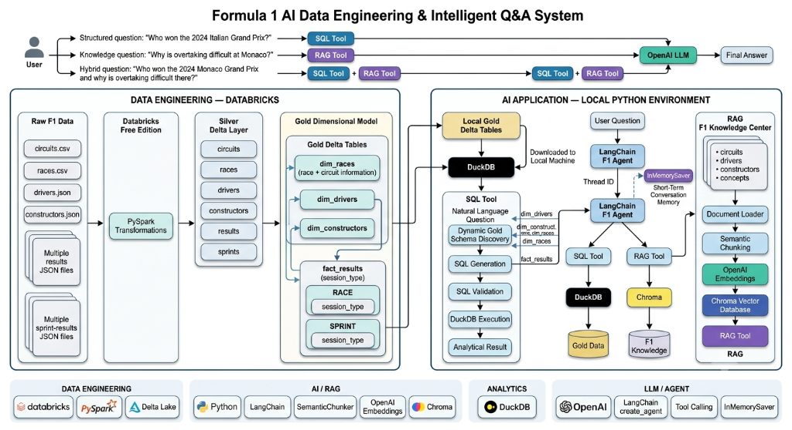
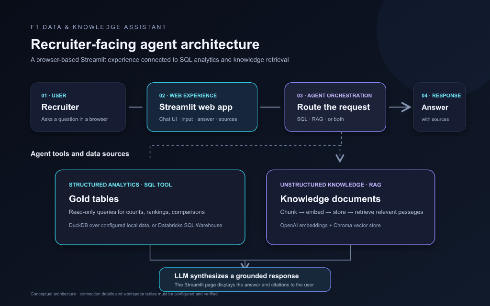

# Apex F1: Data Platform & AI Knowledge Assistant

Formula 1 analytical platform combining Databricks Lakehouse pipelines, Delta Lake storage, and a RAG intelligence assistant.

- Live Application: https://f1agent.streamlit.app/
- GitHub Repository: https://github.com/sandeepmegharaj/F1-Analysis-and-RAG-Agent

---

## System Architecture



---

## Data Engineering Architecture

### Medallion Pipeline Flow
- Bronze Layer: Raw landing from source files (circuits, races, drivers, constructors, results) with ingestion metadata and full audit lineage.
- Silver Layer: Schema conformance, type validation, string normalization, and quarantine handling for irregular records.
- Gold Layer: Analytics-ready dimensional star schema for high-performance querying.

### Gold Star Schema Model
- dim_drivers: Driver profiles, numbers, codes, nationalities.
- dim_constructors: Team identities, nationalities, historical records.
- dim_races: Circuit info, rounds, countries, dates.
- fact_results: Granular race and sprint outcomes, finishing positions, points, lap counts, fastest laps.

### Storage and Query Engines
- Delta Lake: ACID transactions, schema enforcement, time-travel auditing, and Parquet columnar storage.
- Databricks SQL Warehouse: Read-only enterprise query endpoint via Unity Catalog governance.
- DuckDB Delta Scan: Embedded serverless in-memory OLAP engine querying local Delta tables.
- Airflow Orchestration: Automated DAGs (`dags/f1_refresh_dag.py`) for schema verification and index refreshes.

---

## AI Agent & Tool Routing



### Query Routing
- Structured Analytics (SQL Tool): Queries Gold Delta tables via DuckDB or Databricks SQL for counts, points, and rankings.
- Unstructured Knowledge (RAG Tool): Searches persistent ChromaDB vector store for circuits, historical facts, and sporting rules.
- Hybrid Synthesis Tier: Blends structured SQL metrics with semantic document excerpts, returning grounded answers with citations.

---

## Tech Stack

- Lakehouse & Storage: Databricks, Apache Spark, Delta Lake, Apache Parquet
- Query Engines: Databricks SQL Warehouse, DuckDB
- Governance & Orchestration: Unity Catalog, Apache Airflow
- Vector Database: ChromaDB
- LLM & Embeddings: Azure OpenAI / OpenAI GPT-4o, Sentence Transformers
- Framework & App: LangChain, Streamlit, Python 3.10+

---

## Quick Setup & Run

### 1. Clone and Install
```bash
git clone https://github.com/sandeepmegharaj/F1-Analysis-and-RAG-Agent.git
cd F1-Analysis-and-RAG-Agent
python -m venv .venv
source .venv/bin/activate  # Windows: .\.venv\Scripts\Activate.ps1
pip install -r requirements.txt
```

### 2. Configure Environment
```bash
cp .env.example .env
```
Add your `OPENAI_API_KEY` (or Azure OpenAI credentials) and optional Databricks SQL credentials in `.env`.

### 3. Launch Application
```bash
streamlit run app.py
```
Application opens at `http://localhost:8501`. Missing Chroma vector indices are automatically generated on first launch.
